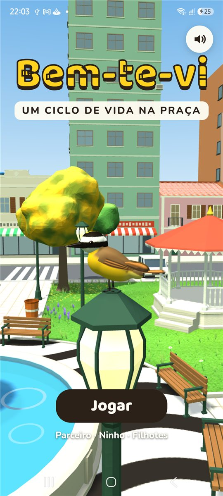
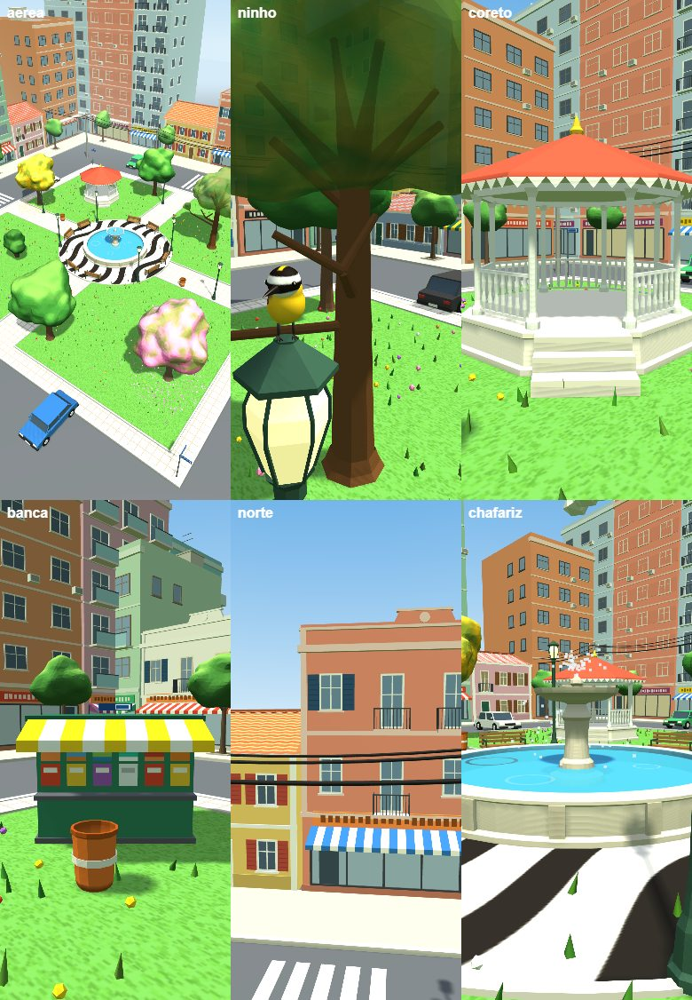
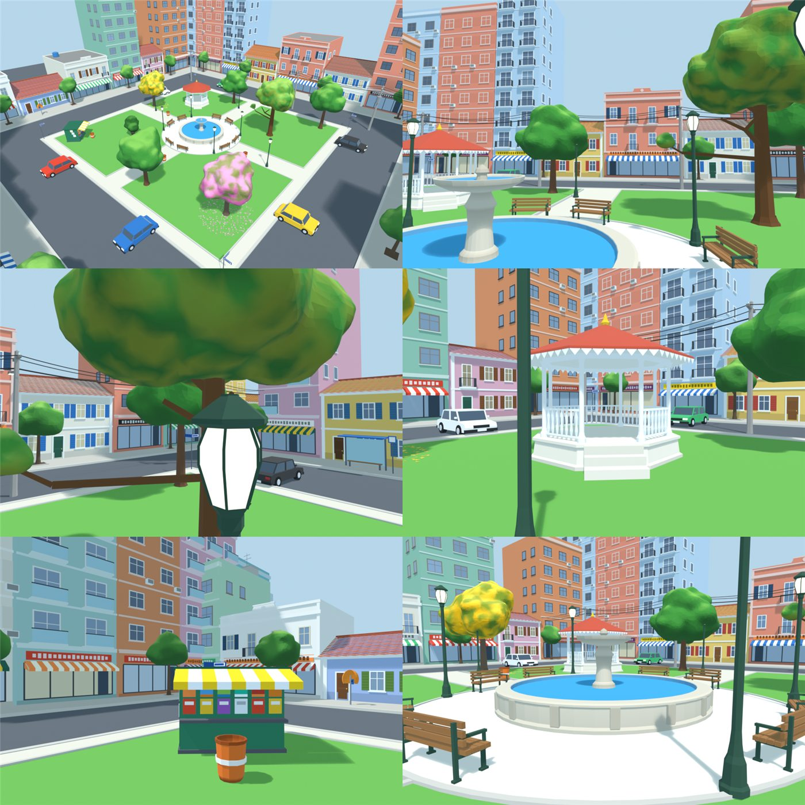
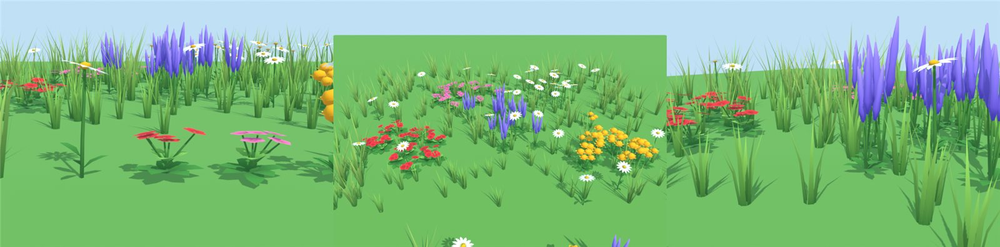
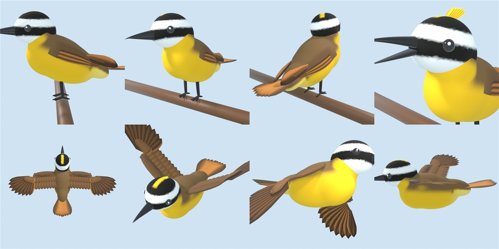
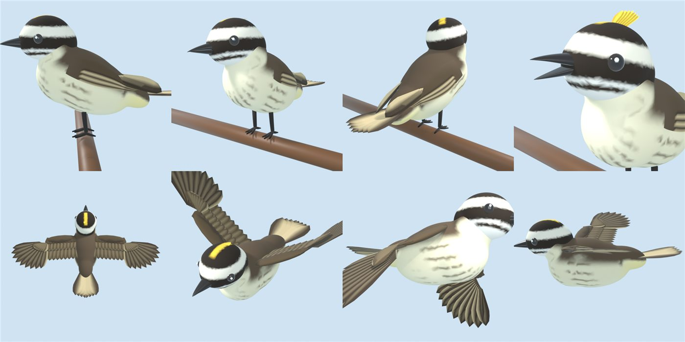
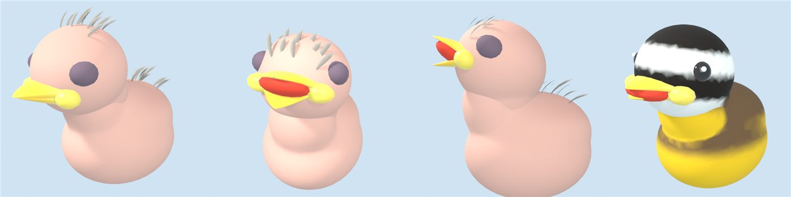
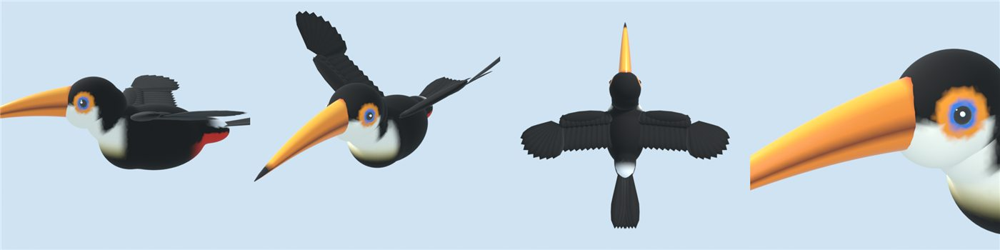
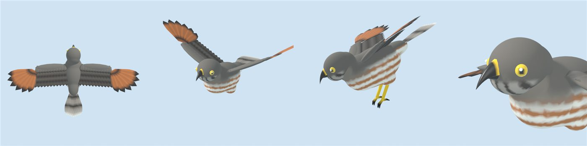
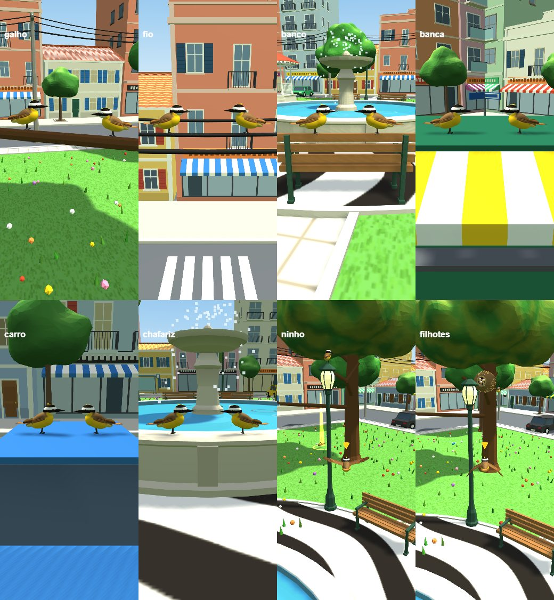

# Bem-te-vi — jogo para Android

Um bem-te-vi vive uma estação inteira numa praça 3D: procura uma parceira voando pela praça, faz o dueto, constrói o ninho e cria os filhotes até o primeiro voo. O design está em [GDD.md](GDD.md).

<p>
  
  
</p>

## Baixar
O APK de teste está em [Releases](../../releases). Copie para o celular, abra o arquivo e permita "instalar apps desconhecidos" quando o Android pedir. Com o celular em modo desenvolvedor e cabo USB: `adb install -r bem-te-vi-debug.apk`.

## Como se joga
| Etapa | O que fazer |
|---|---|
| 1. Procurar uma parceira | Voe pela praça seguindo o canto das bem-te-vis (toque em **Cantar** e elas respondem). Duas já têm par; a que está sozinha faz o dueto com você: repita as notas BEM, TE e VI e erga a crista na hora certa. |
| 2. Construir o ninho | Pegue gravetos e capim (luz amarela) para a estrutura e penas e musgo (luz azul) para o forro. Luz vermelha é lixo. Expulse o bem-te-vi-pirata. |
| 3. Alimentar e proteger | Cace insetos, peixes do chafariz e pitangas para os filhotes e espante tucano, gavião e gato. |

Toque num ponto para voar e arraste para girar a câmera.

## Estrutura
| Caminho | O que é |
|---|---|
| `src/jogo.html` | O jogo inteiro (Three.js + JavaScript). É o único arquivo que você edita. |
| `build.mjs` | Gera `www/index.html`, copia o Three.js para `www/vendor` (funciona sem internet) e embute os `.glb` em `www/modelos.js`. |
| `serve.mjs` | Servidor local para testar no navegador. |
| `arte/` | Scripts do Blender que modelam as aves, a praça e as flores (`modelar_*.py`, base em `aves_comum.py`). Os `.glb` saem em `arte/saida/`. |
| `android/` | Projeto Android gerado pelo Capacitor. |
| `docs/imagens/` | Prévias dos modelos e capturas do jogo. |

## Testar no computador
Requer o Node.js.
```bash
npm install
npm run serve
```
Abra http://localhost:5173. Atalhos: `#etapa1`, `#etapa2` ou `#etapa3` no fim do endereço abre direto na etapa; `#dev` expõe o estado em `window.btvDev`.

## Regerar os modelos (aves, praça e flores)
Requer o Blender 5.x instalado. Num terminal comum (PowerShell ou Prompt):
```bash
npm run modelos
```
Para um modelo só: `node arte/gerar_modelos.mjs pirata` (opções: bemtevi, pirata, filhote, tucano, gaviao, praca, flores). Depois rode `npm run build` para o jogo pegar os novos `.glb`.

## Gerar um novo APK
Requer o Android SDK (vem com o Android Studio) e o JDK 21.
```bash
npm run android:apk
```
No Windows, defina antes `JAVA_HOME` para o JDK 21 (ex.: `C:\Program Files\Eclipse Adoptium\jdk-21...`). O APK sai em `android/app/build/outputs/apk/debug/app-debug.apk`.

Para publicar na Play Store é preciso gerar um AAB assinado (`gradlew bundleRelease` com uma chave de assinatura) — ainda não configurado.

## Modelos feitos no Blender
| | |
|---|---|
|  |  |
|  |  |
|  |  |
|  |  |
